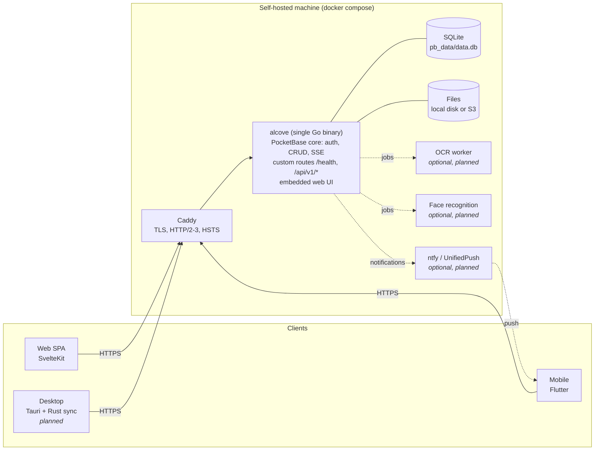
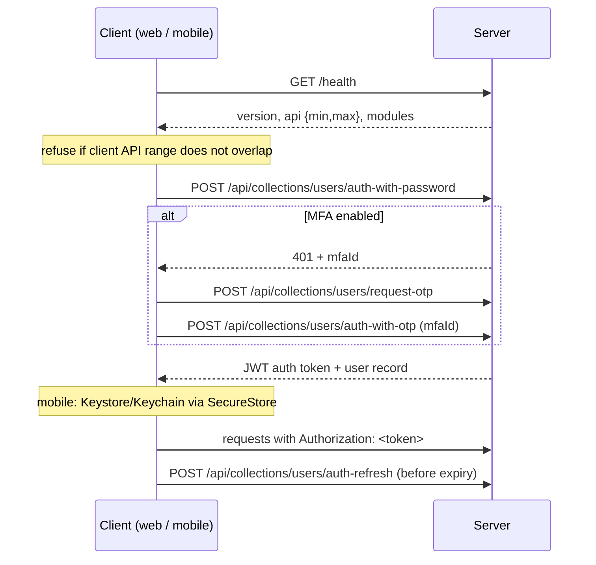

# Architecture

Status: phase 0 (foundations). Sections marked *planned* describe intent, not yet code.
Decisions are recorded in [`adr/`](adr/); this document gives the big picture.

## Overview



- **One process** serves the API, realtime, admin UI (`/_/`) and the web app. SQLite (WAL mode) keeps
  operations trivial: backups are files. See [ADR 0001](adr/0001-single-go-binary-pocketbase.md).
- **Clients are thin.** All of them go through the same HTTP API: PocketBase built-in routes for
  auth/CRUD/realtime, plus custom routes described in `packages/api-spec/openapi.yaml`.
- **Heavy work is optional and out-of-process.** OCR and face recognition run as separate containers
  that the server calls. The core works without them ([ADR 0007](adr/0007-optional-module-containers.md)).

## Server layout

```
server/
  main.go                  wiring only
  internal/buildinfo       name, version, API range (ldflags-overridable)
  internal/config          ALCOVE_* env parsing + validation (fails fast at boot)
  internal/setup           applies env → PocketBase settings on boot; installer link uses public URL
  internal/security        response headers (CSP, nosniff, frame denial, …)
  internal/health          GET /health
  internal/healthcheck     `alcove healthcheck` for the container HEALTHCHECK
  internal/webui           go:embed of web/build, SPA fallback
  migrations/              versioned Go migrations (up + down)
```

Each feature package exposes `Register(app core.App, …)`. Future modules (drive, photos, …) follow
the same shape: `internal/drive` registers its routes, hooks and jobs, and adds its name to `/health.modules`.

## Data model

PocketBase collections. System collections (`_superusers`, `_mfas`, `_otps`, `_authOrigins`,
`_externalAuths`) are managed by PocketBase.

**Current (phase 0):** only the default `users` auth collection, plus settings set by migration
(rate limits, log retention).

**Planned (phase 1, drive):**

| Collection | Key fields | Notes |
|---|---|---|
| `users` (auth) | email, name, avatar, locale, quota_bytes | PocketBase auth collection |
| `nodes` | owner→users, parent→nodes (null = root), name, kind (`file`\|`folder`), size, mime, sha256, blob (file field), trashed_at | Unique (owner, parent, name) among non-trashed. Tree with adjacency list; path computed |
| `shares` | node→nodes, created_by→users, token_hash, permission (`view`\|`edit`), expires_at, password_hash | Public link shares. Only a hash of the token is stored |
| `devices` | user→users, name, platform, push_endpoint, last_seen | For sync state and UnifiedPush |

**Planned (phase 2+):** `media` (node→nodes, taken_at, width, height, duration, exif JSON, geo),
`albums`, `album_items`, `derivatives` (node, kind=`thumb_256`|`preview_1600`|`video_720p`, blob),
`documents` (node, ocr_text, language, FTS5 index), `people`/`faces` (phase 2b, optional module).
Originals are never rewritten. Derivatives live in separate records and can be regenerated.

Access rules are PocketBase API rules on each collection, e.g. `nodes` list/view: `owner = @request.auth.id`
(plus share-token access through a custom route). Rules are part of the migrations, so they are reviewed like code.

## Authentication

PocketBase auth on the `users` collection.



- Tokens are stateless JWTs signed per user. Changing the user's `tokenKey` (password change,
  "log out everywhere") invalidates all of them.
- **2FA:** PocketBase MFA (password + email OTP) first, custom TOTP at the end of phase 1
  ([ADR 0013](adr/0013-2fa-email-otp-then-totp.md)).
- Rate limits apply to `*:auth` (5/min per IP by default), password reset and record creation.
- **Web token storage:** `localStorage` through the PocketBase JS SDK, protected by the strict CSP
  ([ADR 0012](adr/0012-web-token-localstorage.md)).
- **File access:** protected files require a short-lived file token (`POST /api/files/token`,
  minutes-long TTL) appended to the file URL, so leaked URLs expire quickly.

## Realtime

PocketBase exposes server-sent events at `/api/realtime`. A client opens the stream, receives a
`clientId` in `PB_CONNECT`, then subscribes to topics (`nodes`, `nodes/<id>`). Events are filtered by
the same API rules as reads, so a client only sees changes it is allowed to read. Caddy runs with
`flush_interval -1` so events are not buffered.

Mobile apps do not hold a stream in the background. They sync when opened and in periodic background
tasks, with optional UnifiedPush/ntfy wake-ups ([ADR 0010](adr/0010-no-firebase-unifiedpush.md)).

## Storage

- Default: local disk under `pb_data/storage` (Docker volume `alcove_data`).
- Optional: S3-compatible storage (`ALCOVE_STORAGE=s3`, applied to PocketBase's S3 settings at boot).
- *Planned:* content hashing (sha256) at upload for dedup and integrity checks, resumable uploads
  with tus at `/api/v1/uploads/` ([ADR 0011](adr/0011-resumable-uploads-tus.md)), per-user quotas.
- Thumbnails and previews are generated asynchronously into `derivatives`, never into the original.

## Versioning

**Server:** SemVer, injected at build (`buildinfo.Version`, from `git describe`).

**HTTP API:**
- An integer API version `N`. `/health` returns `api: {min, max}`: the range the server serves.
- Custom routes live under `/api/v{N}/…`. Additive changes (new fields, new endpoints) keep the
  same `N`. Breaking changes create `v{N+1}`. The server keeps serving `vN` for at least one minor
  release, then raises `min`.
- Each client declares its own range (`CLIENT_API_RANGE` in TS, `kClientApiRange` in Dart). On connection
  it compares ranges and shows "update the app" or "update the server" instead of failing obscurely.
- PocketBase built-in routes are versioned by the PocketBase version we pin. PocketBase upgrades are
  deliberate (Renovate requires approval) and called out in release notes.
- `openapi.yaml` `info.version` major equals the newest API version.

**Database migrations:**
- Go files in `server/migrations/`, named `<unix-timestamp>_<description>.go`, compiled into the binary
  and applied automatically at start in timestamp order. Applied ones are tracked in `_migrations`.
- Every migration has a `down` that restores the previous state. `alcove migrate down 1` reverts the latest.
- Released migrations are immutable. Fixes are new migrations.
- In dev (`go run`), schema changes made in the admin UI generate migration files automatically. Review and commit them.
- *Planned:* automatic backup before applying pending migrations on upgrade, and CI that runs up → down → up
  on a fresh database.
