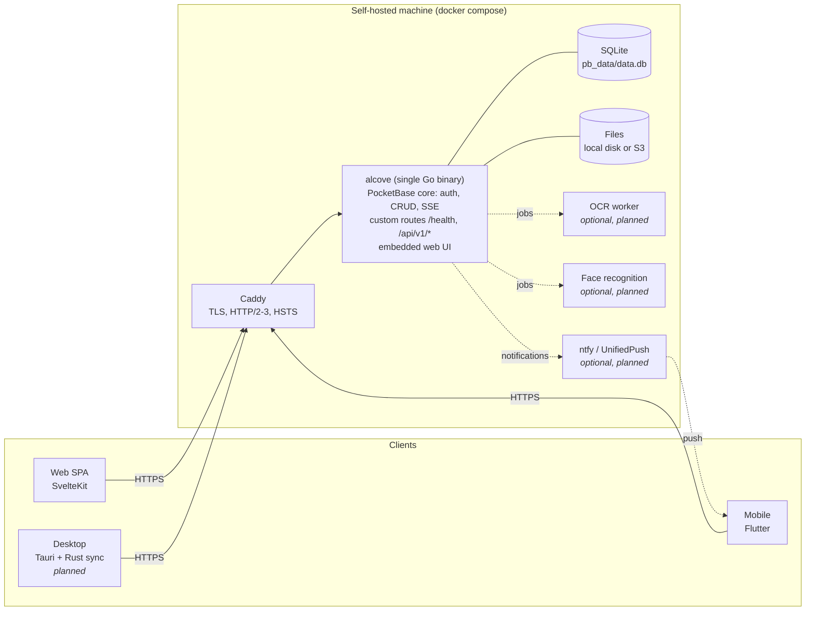
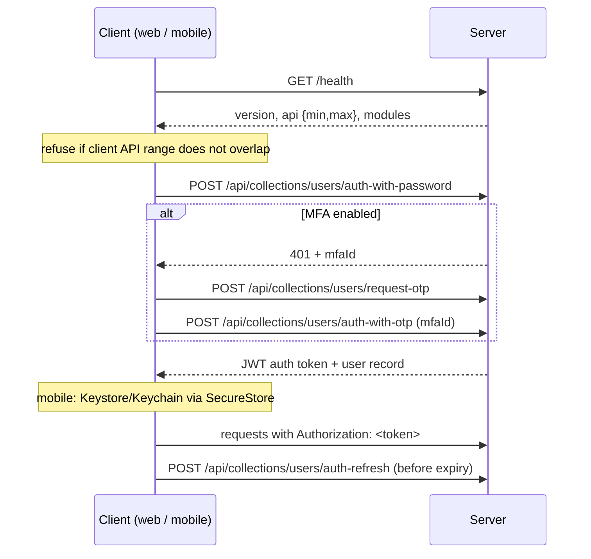

# Architecture

Status: phase 0 (foundations). Sections marked *planned* describe intent, not yet code.
Decisions are recorded in [`adr/`](adr/); this document gives the big picture.

## Overview



- **One process** serves the API, realtime, admin UI (`/_/`) and the web app. SQLite (WAL mode) keeps
  operations trivial: backups are files. See [ADR 0001](adr/0001-single-go-binary-pocketbase.md).
- **Clients are thin.** All of them go through the same HTTP API: PocketBase built-in routes for
  auth/CRUD/realtime, plus custom routes described in `packages/api-spec/openapi.yaml`.
- **Heavy work is optional and out-of-process.** OCR and face recognition run as separate containers
  that the server calls. The core works without them ([ADR 0007](adr/0007-optional-module-containers.md)).

## Server layout

```
server/
  main.go                  wiring only
  internal/buildinfo       name, version, API range (ldflags-overridable)
  internal/config          ALCOVE_* env parsing + validation (fails fast at boot)
  internal/setup           applies env → PocketBase settings on boot; installer link uses public URL
  internal/security        response headers (CSP, nosniff, frame denial, …)
  internal/health          GET /health
  internal/healthcheck     `alcove healthcheck` for the container HEALTHCHECK
  internal/webui           go:embed of web/build, SPA fallback
  internal/drive           nodes invariants, downloads, quotas, trash purge
  internal/media           photo/video metadata (EXIF, ffprobe) and derivatives (ffmpeg), favorites
  internal/maps            map settings (OSM tiles switch) feeding the CSP img-src (ADR 0020)
  internal/duplicates      identical (SHA-256) and similar (dHash + average colour) photo groups
  internal/albums          album hooks (roles, cover, pruning) and reads (list, items, people, lookup)
  internal/notes           notes invariants (tags owned by the note's owner), notes trash purge
  internal/ffbundle        Alcove's own ffmpeg for native Linux installs: verified install, PATH activation
  migrations/              versioned Go migrations (up + down)
```

Each feature package exposes `Register(app core.App, …)`. Future modules (drive, photos, …) follow
the same shape: `internal/drive` registers its routes, hooks and jobs, and adds its name to `/health.modules`.

## Data model

PocketBase collections. System collections (`_superusers`, `_mfas`, `_otps`, `_authOrigins`,
`_externalAuths`) are managed by PocketBase.

**Current:** the default `users` auth collection, locked down by migration: **no public sign-up**
(`createRule = null`, accounts are created by an admin; invitations later), password-reset emails link
to the web app (`/reset-password/{token}`). Settings set by migration: rate limits, log retention.

**Drive (phase 1):** `nodes` exists (migration `1791684000_drive_nodes`, invariants in `internal/drive`):
owner-only rules, server-computed `size`/`mime`/`sha256`, protected `blob`, case-insensitive unique names
per folder among non-trashed nodes, cycle-free moves, cascading deletes. Still planned:

| Collection | Key fields | Notes |
|---|---|---|
| `users` (auth) | email, name, avatar, quota_bytes | PocketBase auth collection. `quota_bytes` (0 = unlimited) is admin-only (update rule forbids it) |
| `nodes` | owner→users, parent→nodes (null = root), name, kind (`file`\|`folder`), size, mime, sha256, blob (file field), trashed_at | Unique (owner, parent, name) among non-trashed. Tree with adjacency list; path computed |
| `shares` | node→nodes, created_by→users, token_hash, access_secret, password_hash, has_password, expires_at | **Implemented** (read-only links). Token shown once, SHA-256 stored; secrets hidden; public routes under `/api/v1/public/` |
| `devices` | user→users, name, platform, push_endpoint, last_seen | For sync state and UnifiedPush |

**Photos (phase 2):** `media` (migration `1791709200_media`) holds one record per image or video node:
`kind`, `status` (`pending` → `ready`|`failed`), `taken_at`, size, duration, camera, lens, exposure,
location, `favorite`, and the derivatives `thumb` (360 px high) and `preview` (1600 px) as protected files.
Owner-only read rules; **no write through the API** (the server fills it, favorites go through
`PUT /api/v1/media/{id}/favorite`). It is deleted with its node (cascade). See [Photos pipeline](#photos-pipeline).

**Albums (v0.11, [ADR 0018](adr/0018-albums-and-sharing-between-accounts.md)):** `albums` (owner, name, cover,
`members` = viewers, `contributors`) and `album_items` (album, media, added_by). Participants read the photos of
their albums through the `media` view rule (`album_items_via_media` back-relation); the list rule stays owner-only.
Drive `nodes` stay owner-only: originals of shared items are served by `GET /api/v1/media/{id}/original`, which
checks the `media` view rule.

**Public album links (v0.12, [ADR 0019](adr/0019-public-album-links.md)):** a `shares` record points to a node or
an album. Visitors get previews and thumbnails (re-encoded, no metadata) and video streams, never original photos,
and no location or camera data.

**Notes (phase 5, [ADR 0027](adr/0027-notes-in-the-database.md)):** `notes` (owner, title, Markdown `body`,
`pinned`, `tags`, `trashed_at`), owner-only rules, written by clients through the record API and synced by
realtime subscriptions. Trashed notes are purged after 30 days.

**Planned (phase 2+):** `video_720p` transcodes (also stripping video metadata),
`documents` (node, ocr_text, language, FTS5 index), `people`/`faces` (phase 2b, optional module).
Originals are never rewritten. Derivatives live in separate records and can be regenerated.

Access rules are PocketBase API rules on each collection, e.g. `nodes` list/view: `owner = @request.auth.id`
(plus share-token access through a custom route). Rules are part of the migrations, so they are reviewed like code.

## Authentication

PocketBase auth on the `users` collection.



- Tokens are stateless JWTs signed per user. Changing the user's `tokenKey` (password change,
  "log out everywhere") invalidates all of them.
- **2FA:** PocketBase MFA (password + email OTP) and authenticator apps (TOTP, `internal/totp`,
  [ADR 0013](adr/0013-2fa-email-otp-then-totp.md)). With TOTP on, `auth-with-password` needs a `totp`
  body field (code or recovery code), checked only after the password is verified; the `totp`
  collection has no API rules; secrets are AES-GCM encrypted with `ALCOVE_SECRET_KEY` or `pb_data/secret.key`.
- Rate limits apply to `*:auth` (5/min per IP by default), password reset and record creation.
- **Web token storage:** `localStorage` through the PocketBase JS SDK, protected by the strict CSP
  ([ADR 0012](adr/0012-web-token-localstorage.md)).
- **File access:** protected files require a short-lived file token (`POST /api/files/token`,
  minutes-long TTL) appended to the file URL, so leaked URLs expire quickly.

## Realtime

PocketBase exposes server-sent events at `/api/realtime`. A client opens the stream, receives a
`clientId` in `PB_CONNECT`, then subscribes to topics (`nodes`, `nodes/<id>`). Events are filtered by
the same API rules as reads, so a client only sees changes it is allowed to read. Caddy runs with
`flush_interval -1` so events are not buffered.

Mobile apps do not hold a stream in the background. They sync when opened and in periodic background
tasks, with optional UnifiedPush/ntfy wake-ups ([ADR 0010](adr/0010-no-firebase-unifiedpush.md)).

## Photos pipeline

1. A `nodes` create/update hook detects images and videos (by MIME) and upserts a `pending` `media` record.
2. A small worker pool (at most 2, so a Raspberry Pi stays responsive) copies the file to a temp dir and reads
   metadata: EXIF with `imagemeta` (size from the decoded header when Go can read it, since EXIF sizes go stale
   after edits), `ffprobe` for videos and HEIC (creation dates, rotation, ISO 6709 location).
3. Every item gets its own thumbnail (360 px high) and preview (1600 px) so album participants never need the
   drive file. `ffmpeg` renders them (2-minute timeout, 2 threads; files are untrusted). JPEG/PNG/WebP
   work without ffmpeg; HEIC (7.1+) and videos need it ([ADR 0016](adr/0016-bundled-ffmpeg.md),
   [0017](adr/0017-ffmpeg-bundle-for-native-linux.md)).
4. The record becomes `ready` (or `failed` with a hidden error). Clients get it through realtime
   subscriptions on `media`. Pending records are resumed at boot and failed ones retried daily.

`taken_at` falls back to the upload date when a file has no date. The web timeline lists `media` sorted by
`-taken_at,-id`, groups it by month and lays it out in justified rows (`web/src/lib/photos/justify.ts`).

## Storage

- Default: local disk under `pb_data/storage` (Docker volume `alcove_data`).
- Optional: S3-compatible storage (`ALCOVE_STORAGE=s3`, applied to PocketBase's S3 settings at boot).
- **Quotas:** usage = sum of the user's file sizes, trash included (`GET /api/v1/me/usage`). Checked when a
  tus upload starts (early 413 `ERR_QUOTA_EXCEEDED`) and again in the `nodes` create/update hook, which
  covers every write path. Concurrent uploads can each pass the first check; the second check decides.
- *Planned:* content hashing (sha256) at upload for dedup and integrity checks, resumable uploads
  with tus at `/api/v1/uploads/` ([ADR 0011](adr/0011-resumable-uploads-tus.md)), per-user quotas.
- **Thumbnails (now):** PocketBase's built-in thumbnails for JPEG/PNG/GIF/WebP in `nodes.blob`
  (`96x96`, `320x320`, `1600x0`), generated lazily on first request and cached next to the file.
  Originals are never touched. Photo and video derivatives (including HEIC) are produced asynchronously
  by the photos pipeline into `media`. RAW and PDF thumbnails come later.
- **Previews:** `GET /api/v1/nodes/{id}/download?inline=1` displays only passive types (images, PDF,
  plain text, MP4/WebM, audio) with a restrictive CSP (sandboxed except PDF). HTML/SVG/XML are always attachments.

## Versioning

**Server:** SemVer, injected at build (`buildinfo.Version`, from `git describe`).

**HTTP API:**
- An integer API version `N`. `/health` returns `api: {min, max}`: the range the server serves.
- Custom routes live under `/api/v{N}/…`. Additive changes (new fields, new endpoints) keep the
  same `N`. Breaking changes create `v{N+1}`. The server keeps serving `vN` for at least one minor
  release, then raises `min`.
- Each client declares its own range (`CLIENT_API_RANGE` in TS, `kClientApiRange` in Dart). On connection
  it compares ranges and shows "update the app" or "update the server" instead of failing obscurely.
- PocketBase built-in routes are versioned by the PocketBase version we pin. PocketBase upgrades are
  deliberate (Renovate requires approval) and called out in release notes.
- `openapi.yaml` `info.version` major equals the newest API version.

**Database migrations:**
- Go files in `server/migrations/`, named `<unix-timestamp>_<description>.go`, compiled into the binary
  and applied automatically at start in timestamp order. Applied ones are tracked in `_migrations`.
- Every migration has a `down` that restores the previous state. `alcove migrate down 1` reverts the latest.
- Released migrations are immutable. Fixes are new migrations.
- In dev (`go run`), schema changes made in the admin UI generate migration files automatically. Review and commit them.
- *Planned:* automatic backup before applying pending migrations on upgrade, and CI that runs up → down → up
  on a fresh database.
